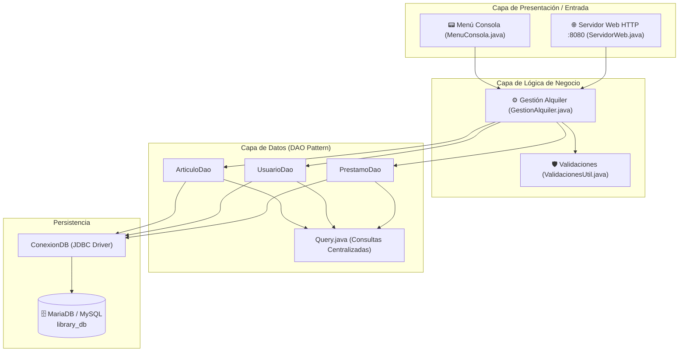

<div align="center">

# 🎬 Bibliomedia · Control de Préstamos Multimedia

[](https://www.oracle.com/java/)
[](https://maven.apache.org/)
[](https://mariadb.org/)
[](http://localhost:8080)
[](#)

<p align="center">
  <strong>Sistema integral de gestión de préstamos de películas y videojuegos para instituciones educativas.</strong><br>
  Control de inventario, validaciones de entrega y trazabilidad de préstamos mediante <strong>interfaz de consola (CLI)</strong> y <strong>servidor web integrado (HTTP 8080)</strong>.
</p>

[✨ Características](#-características-principales) •
[🏛️ Arquitectura](#-arquitectura-del-sistema) •
[🗄️ Base de Datos](#-modelo-de-datos-library_db) •
[🚀 Instalación y Despliegue](#-guía-de-instalación-y-despliegue) •
[🌐 Endpoints Web](#-interfaz-web-y-servicios)

</div>

---

## 📌 Visión General

**Bibliomedia** es una solución backend desarrollada en **Java** bajo una arquitectura desacoplada por capas (**DAO / Service / Model**). Permite administrar el préstamo de material audiovisual e interactivo (películas y videojuegos) a dos perfiles de usuarios: **Alumnos** y **Docentes**.

El sistema opera en modo dual:
1. 📟 **Consola Interactiva (CLI):** Diseñada para operaciones rápidas del bibliotecario o administrador.
2. 🌐 **Portal Web Integrado (`http://localhost:8080`):** Servidor HTTP local con interfaz web responsive construida en HTML5, CSS3 y JavaScript vanilla.

---

## ✨ Características Principales

| Módulo | Descripción |
| :--- | :--- |
| 👥 **Gestión Polimórfica de Usuarios** | Soporte para `Alumno` y `Docente` herederos de `AbstractUsuario`, identificados por DNI/NIE único. |
| 🎮 **Inventario Multimedia** | Catálogo de `Pelicula` y `VideoJuego` derivados de `AbstractArticulo`, gestionados por número de serie. |
| ⏱️ **Control Estricto de Préstamos** | Registro automático de fecha de salida, fecha límite de devolución y cálculo de retrasos/penalizaciones. |
| 🔌 **Persistencia JDBC Optimizada** | Conexión robusta a MariaDB/MySQL mediante `mysql-connector-j` y consultas centralizadas en `Query.java`. |
| 🌐 **Servidor Web Incorporado** | Despliegue de vistas estáticas y API básica sin necesidad de servidores externos pesados (Tomcat/WildFly). |

---

## 🏛️ Arquitectura del Sistema

El proyecto sigue una estructura limpia y desacoplada basada en el patrón **Data Access Object (DAO)**:



---

## 🗄️ Modelo de Datos (`library_db`)

La persistencia se organiza en torno a 3 entidades principales:

```text
+------------------+         1:N         +------------------+
|     USUARIOS     | <------------------ |    PRESTAMOS     |
+------------------+                     +------------------+
| PK dni           |                     | PK id_prestamo   |
|    nombre        |                     | FK dni_usuario   |
|    tipo (ALU/DOC)|                     | FK id_articulo   |
+------------------+                     |    fecha_salida  |
                                         |    fecha_limite  |
+------------------+         1:N         |    fecha_entrega |
|    ARTICULOS     | <------------------ +------------------+
+------------------+
| PK num_serie     |
|    titulo        |
|    tipo (PEL/VID)|
|    disponible    |
+------------------+
```

* **`usuarios`**: Registra tanto a alumnos como a profesores bajo su documento de identidad.
* **`articulos`**: Catálogo unificado de películas y videojuegos con flag de disponibilidad.
* **`prestamos`**: Trazabilidad completa con auditoría de devoluciones a tiempo o con retraso.

---

## 📁 Estructura del Repositorio

```text
alquiler-multimedia-java/
├── pom.xml                               # Configuración de dependencias Maven
└── src/
    └── main/
        ├── java/org/example/
        │   ├── database/                 # Driver y pool de conexión JDBC
        │   │   └── ConexionDB.java
        │   ├── model/                    # Jerarquía de clases POO y dominio
        │   │   ├── AbstractArticulo.java
        │   │   ├── AbstractUsuario.java
        │   │   ├── Alumno.java
        │   │   ├── Docente.java
        │   │   ├── Pelicula.java
        │   │   ├── VideoJuego.java
        │   │   └── Prestamo.java
        │   ├── repository/               # Capa DAO y sentencias SQL
        │   │   ├── ArticuloDao.java
        │   │   ├── UsuarioDao.java
        │   │   ├── PrestamoDao.java
        │   │   └── Query.java
        │   ├── service/                  # Orquestación de negocio y servidores
        │   │   ├── GestionAlquiler.java
        │   │   ├── MenuConsola.java
        │   │   └── ServidorWeb.java
        │   ├── utils/                    # Validadores de datos y formateo
        │   │   └── ValidacionesUtil.java
        │   └── Main.java                 # Punto de entrada de la aplicación
        ├── resources/                    # Scripts DDL y DML
        │   ├── schema.sql                # Creación de tablas y constraints
        │   └── data.sql                  # Semillero de datos de prueba
        └── webapp/                       # Frontend estático (HTML5, CSS, JS)
            ├── index.html
            ├── css/
            └── js/
```

---

## 🚀 Guía de Instalación y Despliegue

### 1. Prerrequisitos
* **Java Development Kit (JDK):** Versión 17 o superior.
* **Apache Maven:** 3.8+ instalado o mediante wrapper del IDE.
* **XAMPP / MariaDB:** Servidor MySQL activo en `localhost:3306`.

### 2. Clonar el Repositorio
```bash
git clone https://github.com/Luaz2021/alquiler-multimedia-java.git
cd alquiler-multimedia-java
```

### 3. Configurar la Base de Datos
1. Inicia el servicio **MySQL** desde el panel de control de **XAMPP**.
2. Accede a **phpMyAdmin** (`http://localhost/phpmyadmin`) o a tu gestor SQL favorito (DBeaver, DataGrip).
3. Ejecuta en orden los scripts ubicados en `src/main/resources/`:
   - 📄 **`schema.sql`** *(crea la base de datos `library_db` y las relaciones)*.
   - 📄 **`data.sql`** *(inserta usuarios y artículos de ejemplo)*.

### 4. Compilar y Ejecutar

#### Desde IntelliJ IDEA / Eclipse:
1. Abre la carpeta del proyecto en tu IDE.
2. Espera que Maven resuelva las dependencias del `pom.xml`.
3. Ejecuta la clase:
   ```text
   src/main/java/org/example/Main.java
   ```

#### Desde Terminal (Maven):
```bash
# Compilar el proyecto
mvn clean package

# Ejecutar la aplicación
mvn exec:java -Dexec.mainClass="org.example.Main"
```

---

## 🌐 Interfaz Web y Servicios

Una vez en ejecución `Main.java`, el sistema levanta simultáneamente:

| Entorno | Acceso | Función |
| :--- | :--- | :--- |
| **CLI (Terminal)** | Consola activa | Menú administrativo por teclado |
| **Web Portal** | [`http://localhost:8080`](http://localhost:8080) | Consulta visual de catálogo y estado de préstamos |

---

## 👥 Autores y Créditos

* **Alexander Martínez ([@Luaz2021](https://github.com/Luaz2021))** — *Desarrollo e Implementación*
* Asistencia técnica y arquitectura: **Nova ✨**

---
<div align="center">
  <sub>Desarrollado con fines académicos y de formación profesional · 2026</sub>
</div>
